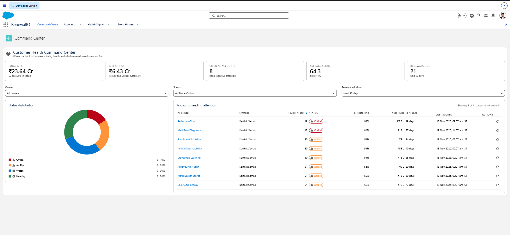
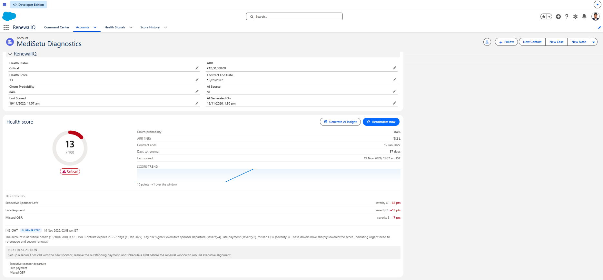
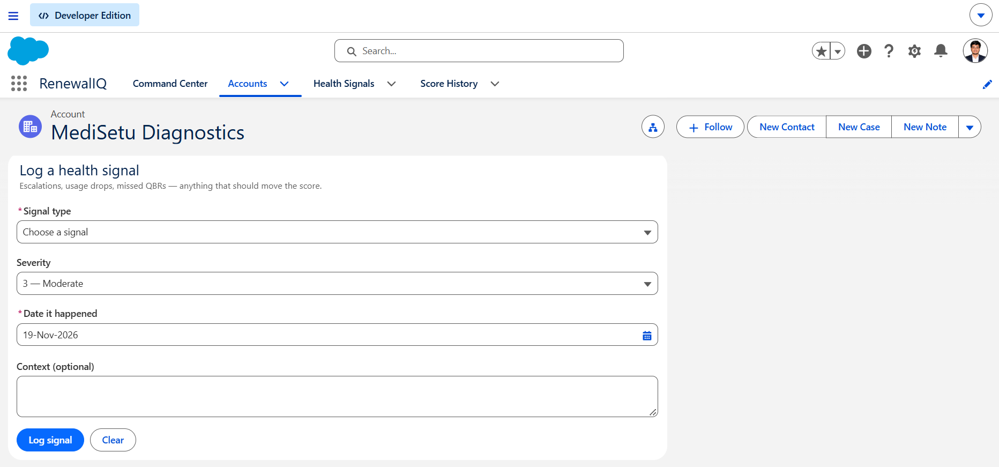
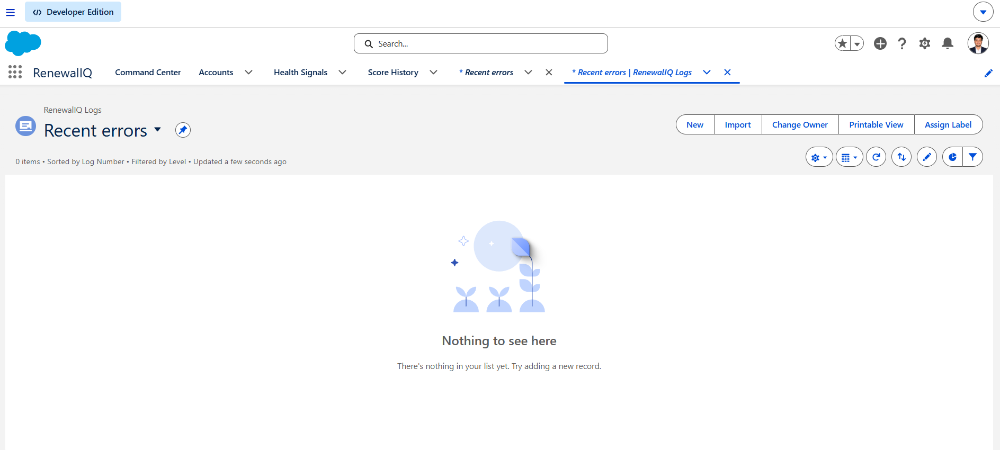
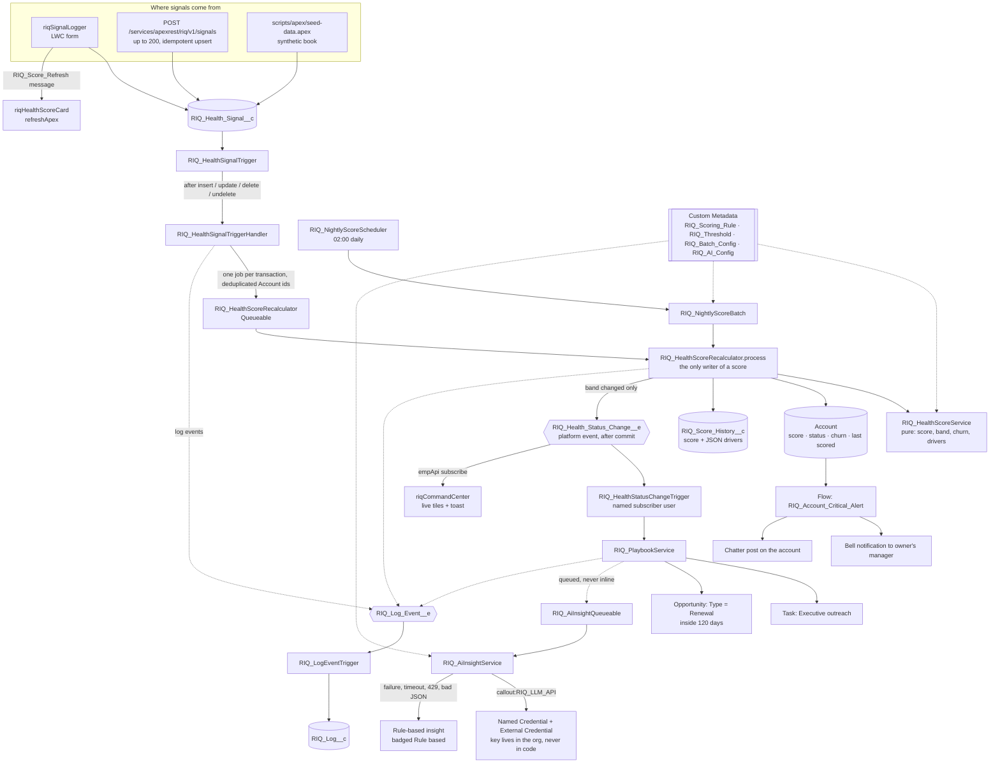
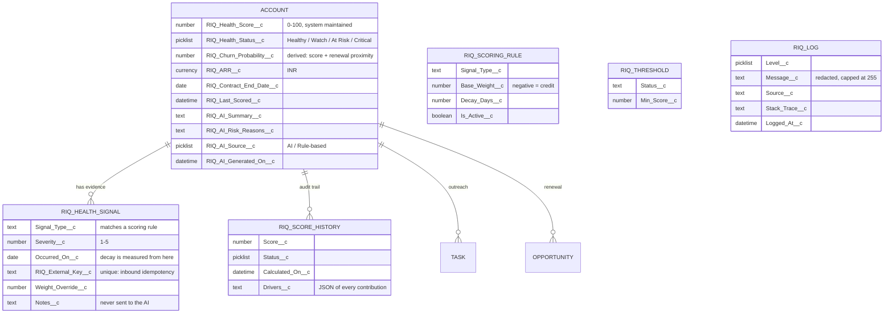

# RenewalIQ — Customer Health & Renewal Command Center

[](https://github.com/karthiksamak-git/renewaliq-salesforce/actions/workflows/ci.yml)
[](LICENSE)

A Salesforce application for the customer-success team of an Indian B2B SaaS company.
It scores every customer account's health from 0 to 100, explains the number, predicts
churn risk, and turns a worsening account into a task and a renewal opportunity before
the renewal conversation happens — instead of after it.

**Built on:** Salesforce DX (source format, API 62.0) · Apex (trigger handler, selector
and service layers) · Custom Metadata driven scoring rules · Lightning Web Components
with Jest tests · Queueable / Batch / Schedulable async · Platform Events · Flow ·
a Groq LLM callout behind a Named Credential · a REST endpoint for inbound signals.

> **Every account, signal and rupee amount on this page is synthetic demo data.** The
> companies are invented. There are no real customers, no real contracts and no personal
> data in this repository. All money is in Indian rupees (INR).

---

## The problem

A B2B SaaS customer-success manager in India carries a book of 40–80 accounts, each
renewing on its own date and each worth ₹5 lakh to ₹4 crore a year. The early warning
signs already exist — a P1 escalation, a drop in active users, a missed QBR, a champion
who left, an invoice paid 40 days late — but they live in five different tools. By the
time someone assembles them into a spreadsheet, the renewal is six weeks away and the
customer has already shortlisted a competitor.

The cost is not "bad customer experience". It is ARR: in this demo book, ₹6.43 crore of
the ₹23.64 crore under management sits on accounts that are At Risk or Critical.

## What it does, and why a CS team would pay for it

| Business outcome                            | How RenewalIQ does it                                                                                                                                                |
| ------------------------------------------- | -------------------------------------------------------------------------------------------------------------------------------------------------------------------- |
| One number per customer, agreed by everyone | A weighted, time-decayed score written to the Account by a single code path, so the dashboard, the record page and the nightly job cannot disagree                   |
| The "why" is never a mystery                | Every recalculation stores the full driver breakdown as JSON, and the record page shows the top three with their point values                                        |
| Risk becomes work, not a report             | A band change publishes a platform event; the subscriber creates an "Executive outreach" task for the owner and, inside 120 days, a renewal Opportunity sized at ARR |
| No task spam                                | Playbook motions are idempotent across event replay and against work a CSM already created                                                                           |
| Ops tunes the model without a developer     | Weights, decay windows and status bands are Custom Metadata records, editable in Setup                                                                               |
| The number stays honest as time passes      | A nightly batch re-scores the whole book, because a signal from 90 days ago should hurt less today                                                                   |
| An AI summary that can be trusted           | A written summary, next best action and risk reasons, badged **AI generated** or **Rule based** so a fallback is never mistaken for a model answer                   |
| External tools feed the same pipeline       | `POST /services/apexrest/riq/v1/signals` upserts up to 200 signals per request, idempotently                                                                         |
| Nothing fails silently                      | Logs are published as platform events and stored in their own transaction, so a line logged inside a rolled-back transaction still survives                          |

## Screenshots

All four are from the live Developer Edition org, on the synthetic demo book. No keys or
auth URLs are visible in any of them.

**Command Center** — the screen a CSM leaves open. Five KPIs (total ARR, ARR at risk,
critical accounts, average score, renewals due), a status donut, and the at-risk table
sorted lowest score first. A band change published by anyone toasts in live over empApi.



**Account record page — AI insight** — gauge, status badge, churn probability, ARR in
lakh/crore, the top three drivers with their point values, score trend, and a written
insight badged **AI GENERATED** with its next best action and risk reasons.



**Account record page — signal logger** — the validated form a CSM uses to record an
escalation, a usage drop or a missed QBR. Severity defaults to 3, the date cannot be in
the future, and the context text is stored on the signal record only.



**Recent errors list view** — `RIQ_Log__c` filtered to errors, the operational side of
the app. This shot is deliberately the _empty_ state: the suite finished cleanly, so the
filtered list has 0 items. That is what "no silent failures" looks like when there are
no failures.



## Architecture



## Data model



`RIQ_Health_Signal__c` and `RIQ_Score_History__c` are master-detail to the Account;
`RIQ_Scoring_Rule__mdt`, `RIQ_Threshold__mdt`, `RIQ_Batch_Config__mdt` and
`RIQ_AI_Config__mdt` are configuration. `RIQ_Health_Status_Change__e` and
`RIQ_Log_Event__e` are platform events and hold no permanent rows.

The score itself:

```
score = clamp(100 - Σ(baseWeight × severity × decayFactor), 0, 100)
decayFactor = clamp(1 - daysSinceOccurred / decayDays, 0, 1)
```

One formula covers penalties and credits — a credit such as Positive Expansion is simply
a negative `Base_Weight__c` — and churn probability is derived from the score plus a
renewal-proximity bonus.

## Design decisions

| Decision                                    | What was chosen                                                                                                           | Why                                                                                                                                                                                                  | What it costs                                                                                                                            |
| ------------------------------------------- | ------------------------------------------------------------------------------------------------------------------------- | ---------------------------------------------------------------------------------------------------------------------------------------------------------------------------------------------------- | ---------------------------------------------------------------------------------------------------------------------------------------- |
| **Queueable vs Batch**                      | Queueable for one transaction's follow-on re-score; Batch for the nightly whole-book pass                                 | The Queueable moves scoring out of the user's request and gives it a retry boundary; only Batch can chunk a book of accounts and re-score accounts nobody touched                                    | Two entry points, both delegating to one `process()` so they cannot drift                                                                |
| **Custom Metadata for rules**               | `RIQ_Scoring_Rule__mdt`, `RIQ_Threshold__mdt`, `RIQ_Batch_Config__mdt`, `RIQ_AI_Config__mdt`                              | Deployable configuration that travels with the code; cached per transaction; ops edits it in Setup without a deployment                                                                              | Every CMDT read is a query unless cached — hence a static cache in `RIQ_ScoringRuleProvider`                                             |
| **Platform Events for the band change**     | `RIQ_Health_Status_Change__e`, publish-after-commit                                                                       | The scorer should not know its consumers; a rolled-back score must not leave an orphan task; new consumers subscribe without editing the scorer                                                      | At-least-once delivery, so every consumer must be idempotent — the playbook is, twice over                                               |
| **Named + External Credential for the LLM** | `RIQ_LLM_API` secured endpoint; the key is an External Credential principal parameter                                     | The secret lives in the org's protected store and is never readable by Apex, so it cannot leak into a log, a test or git                                                                             | Setup is a manual step per org; a scratch org has no key until one is stored                                                             |
| **USER_MODE vs SYSTEM_MODE**                | Selectors and controllers default to `USER_MODE`; the scorer and playbook opt into `SYSTEM_MODE` explicitly               | Score fields are read-only for CSMs, so writing them under the triggering user's permissions would fail for exactly the person logging a signal; the ids come from records that user already touched | The exception is a decision to review, so it is written as `AccessLevel.SYSTEM_MODE` in the code rather than hidden in `without sharing` |
| **Flow vs Apex**                            | The Critical alert is a record-triggered Flow; everything with rules is Apex                                              | "When it goes Critical, tell the manager and post to the feed" is notification policy an admin should change without a deployment                                                                    | Flow logic is harder to unit test, so it carries fault connectors instead                                                                |
| **Rule-based fallback**                     | Every AI failure — timeout, 429, 5xx, empty or malformed content — produces a deterministic summary badged **Rule based** | A user must never see a raw HTTP status, and a fallback must never be indistinguishable from a model answer                                                                                          | Two code paths to maintain, and the badge is a promise the UI has to keep                                                                |

**Rule of thumb:** Flow for policy, Apex for rules, events for decoupling, Batch for
volume, Queueable for latency, Schedulable for the clock.

## Quick start

You need the Salesforce CLI, Node.js 22 or newer (the CLI dropped support for older
runtimes) and Git. **No API key is required** — the AI insight ships disabled and
everything else works without one.

### Option A — one command, fresh scratch org

```bash
git clone https://github.com/karthiksamak-git/renewaliq-salesforce.git
cd renewaliq-salesforce
sf org login web --set-default-dev-hub --alias devhub   # once, if you have no Dev Hub
./scripts/setup.sh                                      # macOS / Linux
```

```powershell
git clone https://github.com/karthiksamak-git/renewaliq-salesforce.git
cd renewaliq-salesforce
sf org login web --set-default-dev-hub --alias devhub   # once, if you have no Dev Hub
powershell -ExecutionPolicy Bypass -File scripts/setup.ps1
```

The script creates a scratch org from `config/project-scratch-def.json`, deploys the
project, assigns all five permission sets, renders the platform-event subscriber config
for that org's user, loads the synthetic demo book, scores it through the real engine,
runs the nightly batch once, schedules both jobs and opens the org. It is idempotent — a
second run reuses the org instead of burning another scratch org.

Then: **App Launcher → RenewalIQ**. The Command Center is the app's landing tab.

```bash
sf org delete scratch --target-org renewaliq --no-prompt   # clean up
```

### Option B — an existing Developer Edition org, by hand

```bash
npm install
sf org login web --alias RenewalIQ --set-default
sf project deploy start --target-org RenewalIQ --wait 45

# Metadata deploys do not grant field access. Assign every set the demo uses.
for p in RIQ_Admin RIQ_CSM RIQ_Read_Only RIQ_AI_Insight RIQ_Integration_User; do
  sf org assign permset --name $p --target-org RenewalIQ
done

sf apex run --file scripts/apex/seed-data.apex        --target-org RenewalIQ
sf apex run --file scripts/apex/run-nightly-batch.apex --target-org RenewalIQ
sf apex run --file scripts/apex/schedule-jobs.apex     --target-org RenewalIQ
```

`scripts/apex/reset-demo-data.apex` deletes only the records these scripts created, so the
book can be reset without touching anything else.

**Developer Edition caveats that actually bite**

- **Two Standard licences.** Both are usually taken, so you cannot create extra users to
  test the Read-Only persona — assign `RIQ_Read_Only` to the second user and use **Log in
  as User**.
- **The app is invisible until a permission set grants it.** That is the design.
- **Scheduled jobs block deployments.** Abort with `scripts/apex/abort-scheduled-jobs.apex`,
  deploy, then re-run `scripts/apex/schedule-jobs.apex`.
- **A scratch org has no Groq key.** The panel shows a **Rule based** summary until you
  store a key in the External Credential principal and tick **Is Enabled** on the
  `RIQ AI Config` record.
- **A fresh Developer Edition ships sample Accounts.** They have no RenewalIQ fields set
  and are not part of the demo book; only the accounts the seed script creates are scored.

## Test strategy, and the evidence for it

The strategy is "test the thing that would break in production, in the shape it breaks
in". Concretely:

- **Apex, against a real org.** Every number below comes from a `RunLocalTests` execution
  against the Developer Edition org on 19 November 2026, not from a mock.
- **Bulk first.** `RIQ_HealthSignalTrigger_Test` inserts 200 signals across 200 accounts in
  one transaction and asserts one history row per account; `RIQ_PlaybookService_Test`
  publishes and delivers 200 events and asserts 200 tasks and 200 renewal opportunities;
  the nightly batch is tested with 201 accounts across two chunks.
- **Edge cases as behaviour, not padding.** A first score (null → band) publishes nothing;
  a signal whose type has no active rule contributes nothing; a band that no longer matches
  the picklist is counted as a failure instead of throwing; deactivating every rule leaves
  the last score alone instead of setting everyone to 100; a full queueable queue skips
  loudly instead of rolling back the signal the CSM just saved.
- **Idempotency is asserted twice**: redelivering the same event and pre-existing open work
  both create nothing.
- **The UI is tested in a shadow DOM.** 71 Jest tests across 4 suites drive the components
  through rendered DOM: filters reaching Apex with the right arguments, validation blocking
  submission, the "score updating" state and its later refresh message, empApi
  subscribe/unsubscribe, the Chart.js fallback donut, and the sparkline caption and
  per-point tooltips. Jest proves behaviour, not appearance.
- **Static analysis gates the build.** PMD via Salesforce Code Analyzer, security,
  performance and error-prone categories: **0 violations** in this session after two
  documented inline suppressions, each with its reason in `docs/SECURITY.md`.

Measured on 19 November 2026 against `RenewalIQ` (org `00Dg800000A02p2EAB`):

| Evidence                      | Result                                                                                                                                               |
| ----------------------------- | ---------------------------------------------------------------------------------------------------------------------------------------------------- |
| Apex tests                    | **198 run, 0 failing, 100% pass**                                                                                                                    |
| Org-wide coverage             | **92%** of 1,927 lines (test-run coverage 94%)                                                                                                       |
| Lowest-covered class          | **90%** — `RIQ_AccountHealthController` (175/195), `RIQ_AiInsightQueueable` (69/77)                                                                  |
| Classes closed out in Phase 8 | `RIQ_NightlyScoreScheduler` **100%**, `RIQ_HealthSignalTriggerHandler` **97%**, `RIQ_PlaybookService` **96%**, `RIQ_HealthScoreRecalculator` **92%** |
| Jest                          | **71 tests, 4 suites, 0 failing**                                                                                                                    |
| PMD (Code Analyzer)           | **0 violations**                                                                                                                                     |
| CI gate                       | org-wide **≥90%** and **no class below 85%** (`scripts/ci/check-coverage.mjs`)                                                                       |
| Demo book                     | 50 RenewalIQ accounts (plus 20 stock Developer Edition sample Accounts, unscored), 162 health signals, 206 score-history rows, 6 log rows            |

CI runs the same suite in a fresh scratch org on every push, then runs PMD, then deletes
the org. See `docs/CI.md`.

## Security model, in one page

Built as if a stolen session token were the threat, not as if the user were trusted.

- **Two layers on every mutation.** `Recalculate` and `Log signal` check a Custom
  Permission (`RIQ_Recalculate_Health`, `RIQ_Log_Health_Signals`) with
  `FeatureManagement.checkPermission` inside Apex. Hiding the button is a convenience;
  the check is the control.
- **`USER_MODE` by default.** Every selector and controller query enforces sharing, CRUD
  and FLS unless it explicitly opts out, and the two opt-outs are documented decisions.
- **No secret in the repository.** The LLM key is an External Credential parameter stored
  in the org. A grep for key-shaped strings across the working tree and the full git
  history finds nothing, and the test suite uses `HttpCalloutMock`, so it never touches
  the network.
- **Log redaction.** `RIQ_Logger` strips bearer tokens, provider keys, email addresses and
  phone numbers, and caps messages at the 255-character platform-event limit.
- **CI authentication.** One GitHub secret holds the `force://` auth URL; the workflow
  writes it to a `mktemp` file with mode 600, logs in with `--sfdx-url-file`, and deletes
  it in the same step. It is never echoed and never becomes a command-line argument.
- **The inbound API is a `with sharing` resource in `USER_MODE`**, with
  `RIQ_Integration_User` as the caller's ceiling, a unique external id as the idempotency
  key, and 400/413 reserved for unreadable or oversized bodies.

The full model — access modes, permission matrix, findings, accepted suppressions — is in
[docs/SECURITY.md](docs/SECURITY.md).

## Known limitations

Honest list, not a wish list:

1. **The signal logger refreshes on a bounded timer, not an event.** Logging a signal
   enqueues a Queueable, so the score cannot be new the instant the form submits. The
   component shows "Score updating…", waits 4 seconds, then publishes on the
   `RIQ_Score_Refresh__c` message channel. If the queue is slow, the card refreshes with
   the old number and the user has to press **Recalculate now** or wait for the next
   refresh. A message published by the Queueable at the end of its run would be strictly
   better.
2. **Developer Edition licence limits.** Two Standard licences, a handful of scratch orgs
   per day, and no ability to create personas freely. The Read-Only and CSM personas are
   tested in Apex and by "Log in as User", not by a real second human.
3. **All demo accounts are owned by one user in a single-user org.** The owner filter, the
   manager lookup in the Flow and the task assignment all work, but they have never been
   exercised with two CSMs holding separate books — "my vs their accounts" is untested at
   the sharing level.
4. **Live AI needs your own Groq key**, stored in the External Credential principal, plus
   **Is Enabled** ticked on the `RIQ AI Config` record. Without it every insight is
   rule-based by design.
5. **A full deployment resets `Is_Enabled__c` to `false`**, because the committed Custom
   Metadata record ships disabled so the project is reproducible without anyone's key.
   Re-enable it in Setup after a full deploy, or deploy only the components you changed.
6. **The screenshots predate the Phase 8 UI polish.** The sparkline caption and the
   visible "Risk reasons" label are in the deployed components but not yet in the images.
7. **The error list view screenshot is empty on purpose.** It shows the filtered
   `RIQ_Log__c` view with 0 rows, which proves the view exists, not that errors were
   captured.

## Roadmap

| Phase | Scope                                                                      | Status  |
| ----- | -------------------------------------------------------------------------- | ------- |
| 1     | Project scaffold, data model, permission sets, synthetic seed              | ✅      |
| 2     | Health scoring engine + score history                                      | ✅      |
| 3     | Nightly batch, platform events, playbook automation, Flow alert            | ✅      |
| 4     | LWC command center, record components, Jest tests                          | ✅      |
| 5     | LLM callout (Named/External Credential), inbound signal REST API           | ✅      |
| 6     | Security review: sharing, CRUD/FLS, injection, secret handling             | ✅      |
| 7     | CI/CD on scratch orgs, one-command setup, repo hygiene                     | ✅      |
| 8     | Coverage close-out, UI polish, portfolio documentation                     | ✅      |
| Next  | Queueable-published score refresh, two-user sharing test, delta deployment | Planned |

## Everyday commands

```bash
# Deploy only what changed
sf project deploy start --target-org RenewalIQ

# Every Apex test with coverage, then the gate
sf apex run test --target-org RenewalIQ --test-level RunLocalTests \
  --code-coverage --result-format json --output-dir test-results
node scripts/ci/check-coverage.mjs test-results

# Lint, format, LWC unit tests
npm run lint
npm run prettier:verify
npm run test:unit

# Static analysis (needs a JDK)
export JAVA_HOME="/path/to/jdk"
sf code-analyzer run --config-file config/code-analyzer.yml \
    --workspace . --rule-selector pmd:RenewalIQApex --view table
```

## Project layout

```
force-app/main/default/
  classes/          services, selectors, trigger handlers, tests
  customMetadata/   scoring rules, thresholds, batch config, AI config
  externalCredentials/, namedCredentials/   RIQ_LLM_API (no secret committed)
  flexipages/       Command Center app page, Account record page
  flows/            RIQ_Account_Critical_Alert (record-triggered)
  lwc/              riqCommandCenter, riqHealthScoreCard, riqSignalLogger, riqUtils (+ Jest)
  messageChannels/  RIQ_Score_Refresh
  objects/          Account fields, signals, history, platform events, RIQ_Log__c
  permissionsets/   RIQ_Admin, RIQ_CSM, RIQ_Read_Only, RIQ_AI_Insight, RIQ_Integration_User
  staticresources/  chartjs (served from the org, no CDN at runtime)
scripts/apex/       seed, reset, demo scenario, batch, schedules, callout check
scripts/ci/         coverage gate
scripts/setup.sh, setup.ps1   one-command install
config/             scratch org definition, PMD ruleset, Code Analyzer config, event template
docs/               API, CI, data model, integrations, interview notes, security, screenshots
```

## Documentation

- [docs/DATA_MODEL.md](docs/DATA_MODEL.md) — objects, fields, scoring configuration
- [docs/INTEGRATIONS.md](docs/INTEGRATIONS.md) — LLM callout setup, provider switch, troubleshooting
- [docs/API.md](docs/API.md) — inbound signal API: auth, payload, responses, idempotency
- [docs/INTERVIEW_NOTES.md](docs/INTERVIEW_NOTES.md) — design decisions per phase
- [docs/INTERVIEW_QA.md](docs/INTERVIEW_QA.md) — 30 likely interview questions with honest answers
- [docs/SECURITY.md](docs/SECURITY.md) — security model, permission matrix, findings, static analysis
- [docs/CI.md](docs/CI.md) — workflows, `SFDX_AUTH_URL`, Dev Hub limits, the coverage and PMD gates
- [docs/SCREENSHOTS.md](docs/SCREENSHOTS.md) — screenshot checklist and what each shot proves
- [CONTRIBUTING.md](CONTRIBUTING.md) — branching, the gates a PR must pass, code conventions
- [LICENSE](LICENSE) — MIT
